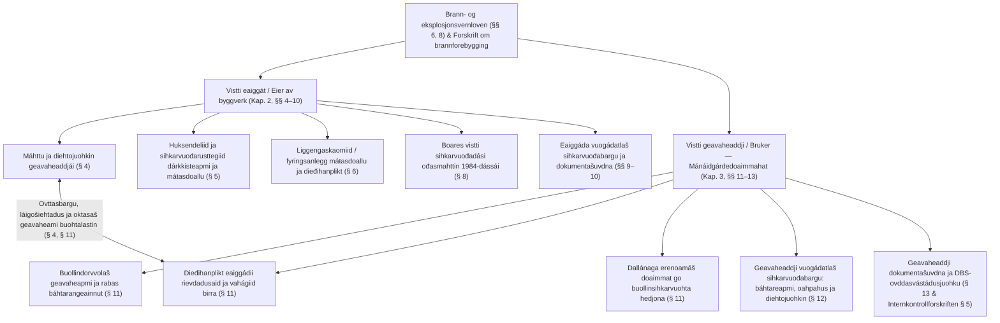

# Buollinvárjalus mánáidgárddiin Norggas — láhkavuođđu, ovddasvástádusjuohku, teknihkalaš gáibádusat ja báhtaranrutiinnat

Buollinvárjalus mánáidgárddiin (*brannvern i barnehager*) lea čadnojuvvon máŋgga našuvnnalaš láhkii ja láhkaásahussii, mat oktasaččat galget várjalit mánáid, bargiid, birrasa ja ávnnaslaš árvvuid buollima ja eará fáhkka lihkohisvuođaid vuostá[^lovdata-lov-2002-06-14-20] [^lovdata-for-2015-12-17-1710] [^helsedir-helse-miljo-14]. Dát regulerenbagadus čohkke Norgga gustovaš láhkavuođu, vistti eaiggáda (*eier*) ja geavaheaddji (*bruker*) gaskasaš ovddasvástádusjuogu, huksen- ja buollinteknihkalaš gáibádusaid, báhtaran- ja hárjehallanrutiinnaid sihke suohkanlaš bearráigeahču njuolggadusaid[^lovdata-for-2015-12-17-1710] [^lovdata-for-2017-06-19-840].

---

## 1. Láhkavuođđu ja láhkaásahusat (*Juridisk og regulatorisk rammeverk*)

Norgga mánáidgárddiid buollinvárjalus vuođđuduvvá viđa váldoláhkii ja -láhkaásahussii, maid stáhta eiseválddit — **Servodatsihkarvuođa ja gearggusvuođa direktoráhtta** (*Direktoratet for samfunnssikkerhet og beredskap — DSB*), **Huksenkvalitehta direktoráhtta** (*Direktoratet for byggkvalitet — DiBK*), **Dearvvašvuođadirektoráhtta** (*Helsedirektoratet*), **Oahpahusdirektoráhtta** (*Utdanningsdirektoratet — Udir*) ja **Bargobearráigeahčču** (*Arbeidstilsynet*) — hálddašit ja bagadit[^dsb-veiledning-brannforebygging] [^dibk-tek17-11-2] [^helsedir-helse-miljo-14] [^udir-sikkerhet-beredskap] [^arbeidstilsynet-internkontroll].

### 1.1 Buollin- ja bávkkáhanvárjalusláhka (*Brann- og eksplosjonsvernloven, LOV-2002-06-14-20*)

Láhka [Brann- og eksplosjonsvernloven (LOV-2002-06-14-20)](/references/lovdata-brann-eksplosjonsvernloven.md) lea buot buollinvárjalusbarggu bajimus láhkavuođđu Norggas[^lovdata-lov-2002-06-14-20]:

- **Ulbmil (`§ 1. Formål`)**: Lága ulbmil lea várjalit heakka, dearvvašvuođa, birrasa ja ávnnaslaš árvvuid buollima ja bávkkáhusa vuostá, váralaš ávdnasiiguin ja váralaš gálvvuiguin čuožžilan lihkohisvuođaid ja eará fáhkka lihkohisvuođaid vuostá, sihke sávakeahtes iešdáhtolaš dáhpáhusaid (*uønskede tilsiktede hendelser*) vuostá[^lovdata-lov-2002-06-14-20].
- **Juohkehačča várrogasvuođa- ja dieđihangeatnegasvuohta (`§ 5. Den enkeltes plikt til å forebygge og begrense skadevirkningene ved brann, eksplosjon og annen ulykke`)**: Juohkehaš lea geatnegas čájehit dábálaš várrogasvuođa (*alminnelig aktsomhet*) ja láhttet nu ahte buollin, bávkkáhus ja eará lihkohisvuohta eastaduvvo[^lovdata-lov-2002-06-14-20]. Buollima dahje lahkanan vára oktavuođas galgá juohkehaš **dallánaga dieđihit daidda, geat leat váras**, ja dárbbu mielde **dieđihit heahtealárbmaguovddážii** (*varsle nødalarmeringssentral*), sihke návccaid mielde dahkat dan mii lea vejolaš vahágiid ráddjemii[^lovdata-lov-2002-06-14-20].
- **Eastadeaddji sihkkarastindooaimmat ja máŧasdoallu (`§ 6. Forebyggende sikringstiltak og vedlikehold`)**: Vistti eaiggát (*eier av byggverk*) lea geatnegas fuolahit dárbbašlaš sihkkarastindoaimmaid buollima eastadeapmái ja ráddjemii[^lovdata-lov-2002-06-14-20]. Sihke vistti **eaiggát ja geavaheaddji** (*eier og bruker*) leat geatnegasat doallat huksenteknihkalaš konstrukšuvnnaid, sihkarvuođarusttegiid ja eará sihkkarastindoaimmaid dohkálaš ortnegis (*i forsvarlig stand*) ja gozihit ahte dat juohke áigge doibmet ulbmila mielde[^lovdata-lov-2002-06-14-20].
- **Stuorra doalut (`§ 7. Tiltak ved store arrangementer`)**: Dat gii lea ovddasvástideaddji stuorra doaluin, čájáhusain, čájálmasain, čoahkkimiin ja eará dilálašvuođain, galgá buori áiggis ovdal doaluid sáddet dieđu báikkálaš bearráigeahččoeiseváldái (*lokal tilsynsmyndighet*), jos doalut lágiduvvojit visttis dahje guovllus mii dábálaččat ii geavahuvvo dakkár doaluide[^lovdata-lov-2002-06-14-20].
- **Vuogádatlaš dearvvašvuođa-, biras- ja sihkarvuođabargu (`§ 8. Systematisk helse-, miljø- og sikkerhetsarbeid`)**: Doaimmahagat (*virksomheter*) leat geatnegasat čađahit vuogádatlaš DBS-barggu (*internkontroll*) sihkkarastin dihte ahte lága gáibádusat čuvvojuvvojit, ja dat galgá sáhttit duođaštuvvot bearráigeahččoeiseválddiide[^lovdata-lov-2002-06-14-20].
- **Erenoamáš buollinčuozáhagat (`§ 13. Særskilte brannobjekter`)**: Suohkan galgá identifiseret, čállit logahallama ja čađahit bearráigeahču (*tilsyn*) visttiin ja doaimmahagain gos buollin sáhttá dagahit ahte máŋga heakka duššet dahje šaddet stuorra vahágat dearvvašvuhtii, birrasii dahje ávnnaslaš árvvuide[^lovdata-lov-2002-06-14-20].

### 1.2 Buollineastadeami láhkaásahus (*Forskrift om brannforebygging, FOR-2015-12-17-1710*)

Láhkaásahus [Forskrift om brannforebygging (FOR-2015-12-17-1710)](/references/lovdata-brannforebygging.md) bođii fápmui 1.1.2016 ja dárkkilastá juohkehačča, vistti eaiggáda, vistti geavaheaddji ja suohkana buollineastadangeatnegasvuođaid[^lovdata-for-2015-12-17-1710] [^dsb-veiledning-brannforebygging]:

- **Dábálaš várrogasvuođa gáibádusat ja dolastallan olgun (`§ 3. Generelle krav til aktsomhet`)**: Lea gildojuvvon cahkkehit dola dahje gieđahallat buollinváralaš dávviriid olgun dakkár dilis dahje dakkár vugiin ahte dat sáhttá dagahit buollima[^lovdata-for-2015-12-17-1710]. Cahkkehuvvon dola ii oaččo guođđit ovdal go dat lea oalát časkaduvvon (*fullstendig slokket*)[^lovdata-for-2015-12-17-1710]. Áigodagas **cuoŋománu 15. beaivvis čakčamánu 15. beaivái** (*15. april til 15. september*) lea gildojuvvon cahkkehit dola dahje gieđahallat buollinváralaš dávviriid vuovddis ja eará meahcis (*i eller i nærheten av skog og annen utmark*), earret go suohkan lea addán lobi, suohkanstivra lea báikkálaš láhkaásahusa bokte suovvan dan, dahje lea čielggas ahte buollin ii sáhte čuožžilit[^lovdata-for-2015-12-17-1710]. Go buollinvárra lea erenoamáš stuoris, sáhttá suohkan ásahit erenoamáš dolastallangildosa gitta **60 beaivái**[^lovdata-for-2015-12-17-1710]. Dát njuolggadus guoská njuolga mánáidgárddiid meahcce- ja dolastallanmátkkiide[^lovdata-for-2015-12-17-1710].
- **Vistti eaiggáda geatnegasvuođat (`Kapittel 2, §§ 4–10`)**: Reguleret eaiggáda máhtu ja diehtojuohkima (`§ 4`), huksendeliid ja sihkarvuođarusttegiid dárkkisteami ja máŧasdoalu (`§ 5`), liggengaskaomiid (*fyringsanlegg*, `§ 6`), ásodagaid ja astoáigevistiid suovvadieđiheddjiid ja časkadanrusttegiid (`§ 7`), boares vistiid ođasmahttima (`§ 8`), eaiggáda vuogádatlaš sihkarvuođabarggu (`§ 9`) ja eaiggáda dokumentašuvnna (`§ 10`)[^lovdata-for-2015-12-17-1710].
- **Vistti geavaheaddji geatnegasvuođat (`Kapittel 3, §§ 11–13`)**: Reguleret vistti buollindorvvolaš geavaheami (`§ 11`), geavaheaddji vuogádatlaš sihkarvuođabarggu (`§ 12`) ja geavaheaddji dokumentašuvnna (`§ 13`)[^lovdata-for-2015-12-17-1710].

### 1.3 Siskkáldas bearráigeahču láhkaásahus (*Internkontrollforskriften, FOR-1996-12-06-1127*)

Láhkaásahus [Internkontrollforskriften (FOR-1996-12-06-1127)](/references/lovdata-internkontroll.md) (`Forskrift om systematisk helse-, miljø- og sikkerhetsarbeid i virksomheter`) guoská buot doaimmahagaide mat gullet earret eará bargobiraslága (*arbeidsmiljøloven, lov 17. juni 2005 nr. 62*) ja buollin- ja bávkkáhanvárjaluslága (*brann- og eksplosjonsvernloven, lov 14. juni 2002 nr. 20*) siskkožii (`§ 2`)[^lovdata-for-1996-12-06-1127] [^arbeidstilsynet-internkontroll].

- **Ovddasvástádus ja mieldeváikkuheapmi (`§ 4`)**: Dat gii lea ovddasvástideaddji doaimmahagas galgá fuolahit ahte siskkáldas bearráigeahčču ásahuvvo ja čađahuvvo ovttasbarggus bargiiguin ja sin ovddasteddjiiguin[^lovdata-for-1996-12-06-1127]. Bargit galget váikkuhit mielde (*medvirke*)[^lovdata-for-1996-12-06-1127].
- **Siskkáldas bearráigeahču 8 váldočuoggá ja čálalaš dokumentašuvdnagáibádus (`§ 5`)**: Siskkáldas bearráigeahčču galgá heivehuvvot doaimmahaga šládjii, doaimmaide, várrodillái ja sturrodatdássái[^lovdata-for-1996-12-06-1127]. Láhkaásahusa `§ 5` nuppi lađđasa tabealla mielde galget čuoggát **4–8** alo dokumenterejuvvot čálalaččat (*må dokumenteres skriftlig*)[^lovdata-for-1996-12-06-1127]:
  1. Fuolahit ahte gustovaš DBS-lágat ja -láhkaásahusat leat olámuttos, ja atnit bajilgova earenoamáš dehálaš gáibádusain[^lovdata-for-1996-12-06-1127].
  2. Fuolahit ahte bargiin leat doarvái máhtut ja gálggat vuogádatlaš DBS-barggus, maiddái dieđut rievdadusaid birra[^lovdata-for-1996-12-06-1127].
  3. Fuolahit ahte bargit váikkuhit mielde nu ahte oppalaš máhttu ja vásáhusat ávkkástallojuvvojit[^lovdata-for-1996-12-06-1127].
  4. **Mearridit DBS-mihtuid** — *galgá dokumenterejuvvot čálalaččat* (*må dokumenteres skriftlig*)[^lovdata-for-1996-12-06-1127].
  5. **Atnit bajilgova doaimmahaga organisašuvnnas, dás maiddái mo ovddasvástádus, barggut ja váldi DBS-barggus leat juhkkojuvvon** — *galgá dokumenterejuvvot čálalaččat*[^lovdata-for-1996-12-06-1127].
  6. **Kártet váraid ja váttisvuođaid, árvvoštallat riskka ja ráhkadit plánaid ja doaimmaid riskkaid unnidit** — *galgá dokumenterejuvvot čálalaččat*[^lovdata-for-1996-12-06-1127].
  7. **Álggahit rutiinnaid mat gávnnahit, njulget ja eastadit láhkarihkkumiid ja spiehkastagaid** — *galgá dokumenterejuvvot čálalaččat*[^lovdata-for-1996-12-06-1127].
  8. **Čađahit vuogádatlaš goziheami ja siskkáldas bearráigeahču čađageahču sihkkarastin dihte ahte dat doaibmá eaktuduvvon láhkai** — *galgá dokumenterejuvvot čálalaččat*[^lovdata-for-1996-12-06-1127].

### 1.4 Huksenteknihkalaš láhkaásahus (*Byggteknisk forskrift — TEK17, FOR-2017-06-19-840*)

Láhkaásahus [Byggteknisk forskrift (TEK17, FOR-2017-06-19-840)](/references/lovdata-tek17-kap11.md) (`Kapittel 11. Sikkerhet ved brann`) mearrida teknihkalaš funkšuvdnagáibádusaid ja Huksenkvalitehta direktoráhta (*DiBK*) bagadus addá ovddalgihtii dohkkehuvvon buktagiid (*preaksepterte ytelser*) visttiid buollinsihkarvuhtii, risikoklássaide (`§ 11-2`), buollinklássaide (`§ 11-3`), báhtareapmái ja gádjumii (`§§ 11-11 til 11-14`) sihke manuála časkadeapmái (`§ 11-16`)[^lovdata-for-2017-06-19-840] [^dibk-tek17-11-2].

### 1.5 Mánáidgárdeláhka ja láhkaásahus dearvvašvuođa ja birrasa birra mánáidgárddiin, skuvllain ja SFO:s (*Barnehageloven og Forskrift om helse og miljø i barnehager, skoler og skolefritidsordninger*)

Buollinláhkavuođu lassin gustojit mánáidgárdesuorggi iežas dearvvašvuođa-, biras- ja gearggusvuođanjuolggadusat[^helsedir-helse-miljo-4] [^helsedir-helse-miljo-14] [^udir-sikkerhet-beredskap]:

- **Dearvvašvuođa dáfus dohkálaš doaibma (`§ 4. Helsemessig tilfredsstillende virksomhet`)**: Mánáidgárddi lanjat ja olgoguovllut galget ovddidit dearvvašvuođa, trivsela, stoahkama ja oahppama buot mánáide, váldit vuhtii mánáid geain lea doaibmahehttehus (*funksjonsnedsettelse*), ja eastadit dávddaid, roasuid, lihkohisvuođaid, veahkaválddi ja **eará duođalaš dáhpáhusaid** (*andre alvorlige hendelser*)[^helsedir-helse-miljo-4].
- **Gearggusvuohta, vuosttašveahkki ja sihkarvuođarusttegat (`§ 14. Beredskap, førstehjelp og sikkerhetsutstyr`)**: Doaimmahagas galget leat plánat ja rutiinnat roasuid, lihkohisvuođaid ja eará duođalaš dáhpáhusaid eastadeapmái ja gieđahallamii[^helsedir-helse-miljo-14]. Dearvvašvuođadirektoráhta bagadus čielggada ahte **buollin** (*brann*) lea okta dáin duođalaš dáhpáhusain, ja ahte plánat ja rutiinnat fertejit vuođđuduvvot **riska- ja rašesvuođaanalysii** (*risiko- og sårbarhetsanalyse — ROS-analyse*) ja gullat doaimmahaga siskkáldas bearráigeahččovuogádahkii[^helsedir-helse-miljo-14] [^udir-sikkerhet-beredskap]. Rutiinnat ja sihkarvuođarusttegiid sajádat galget leat oahppásat sihke bargiide ja mánáide, ja bargiin galgá leat heivehuvvon oahpahus rusttegiid geavaheamis ja vuosttašveahkis[^helsedir-helse-miljo-14].
- **Siskkáldas bearráigeahčču (`§ 18. Internkontroll`)**: Mánáidgárddis galgá leat vuogádatlaš siskkáldas bearráigeahčču mii lea čielggaduvvon Oahpahusdirektoráhta (*Udir*) ja Dearvvašvuođadirektoráhta bagadusain[^helsedir-helse-miljo-18] [^udir-internkontroll]. Doaimmahaga eaiggádis (*virksomhetens eier*, jfr. `§ 3`) lea bajimus ovddasvástádus siskkáldas bearráigeahčus ja dárbbašlaš resurssaid juolludeamis, vaikko barggut sáhttet juohkásit ja delegerejuvvot[^helsedir-helse-miljo-18].

---

## 2. Ovddasvástádusjuohku — Eaiggát vs. Geavaheaddji (*Ansvarsfordeling: Byggeier vs. Bruker*)

[Brann- og eksplosjonsvernloven (LOV-2002-06-14-20)](/references/lovdata-brann-eksplosjonsvernloven.md) `§ 6` ja [Forskrift om brannforebygging (FOR-2015-12-17-1710)](/references/lovdata-brannforebygging.md) `Kapittel 2 (§§ 4–10)` ja `Kapittel 3 (§§ 11–13)` juohket buollinvárjalusa geatnegasvuođaid čielgasit **vistti eaiggáda** (*eier av byggverk*) ja **vistti geavaheaddji** (*bruker av byggverk / barnehagevirksomheten*) gaskkas[^lovdata-lov-2002-06-14-20] [^lovdata-for-2015-12-17-1710].

### 2.1 Guovddáš doahpagat ja rollat DSB bagadusa mielde

- **Vistti eaiggát (*Eieren*)**: DSB bagadusa (`Veiledning til § 10`) mielde lea eaiggát dat geas lea visttiopmodaga vuođđogirjevuoigatvuohta (*den som har grunnbokshjemmelen til byggverket*)[^dsb-veiledning-brannforebygging]. Suohkanlaš mánáidgárddiin lea suohkan dávjá sihke vistti eaiggát ja geavaheaddji, muhto priváhta mánáidgárddiin dahje láigovisttiin sáhttá vistti eaiggát leat eará fitnodat go mánáidgárdedoaimmahat[^dsb-faq-brannforebygging] [^helsedir-helse-miljo-18].
- **Vistti geavaheaddji (*Brukeren*)**: Geavaheaddji lea dat geas lea vuoigatvuohta geavahit vistti (*den som har rett til å bruke byggverket*)[^lovdata-for-2015-12-17-1710]. DSB čielggada ahte jus visti láigojuvvo viidáseappot (*fremleie*), de geavaheaddji lea láigogollosa maŋimus lađas — dat gii duođai geavaha vistti beaivválaččat[^dsb-faq-brannforebygging]. Eaiggádis lea ovddasvástádus sihkkarastit ahte dieđut vistti buollinsihkarvuođa gáibádusaid ja iešvuođaid birra ollejit gitta duohta geavaheaddjái[^dsb-faq-brannforebygging].
- **Doaimmahat (*Virksomhet*)**: DSB čujuha dasa ahte `Brann- og eksplosjonsvernloven § 4 bokstav f` defineren doahpagii *"virksomhet"* fátmmasta juohke almmolaš ja priváhta fitnodaga beroškeahttá das leago fitnodat ásahuvvon gávppálaš vuoittu várás vai ii, nu ahte buot mánáidgárddit gullet doaimmahatgáibádusaid (`§§ 9–10` ja `§§ 12–13`) vuollái[^dsb-faq-brannforebygging] [^dsb-veiledning-brannforebygging].
- **Buollinvárjalusjođiheaddji (*Brannvernleder*) ja ovddasvástádusa delegeren**: Gustovaš `Forskrift om brannforebygging (FOR-2015-12-17-1710)` ii geavat láhkateavsttas sierra virgenamahusa *"brannvernleder"*, muhto bidjá juridihkalaš geatnegasvuođa njuolga **doaimmahahkii** (*virksomheten*) eaiggádin (`§ 9`) ja geavaheaddjin (`§ 12`)[^lovdata-for-2015-12-17-1710]. Seammás gáibida [Internkontrollforskriften (FOR-1996-12-06-1127)](/references/lovdata-internkontroll.md) `§ 5 nr. 5` ja `Forskrift om helse og miljø i barnehager, skoler og skolefritidsordninger § 18` ahte doaimmahat galgá čálalaččat dokumenterejuvvon bajilgovas čájehit **mo ovddasvástádus, barggut ja váldi leat juhkkojuvvon** organisašuvnnas[^lovdata-for-1996-12-06-1127] [^helsedir-helse-miljo-18]. Mánáidgárddis sáhttet praktihkalaš buollinvárjalusbarggut delegerejuvvot mánáidgárdejođiheaddjái (*styrer*) dahje nammaduvvon buollinvárjalusovddasteaddjái, muhto bajimus juridihkalaš ovddasvástádus bissu alo doaimmahaga ovddasvástideaddjis[^lovdata-for-1996-12-06-1127] [^helsedir-helse-miljo-18].

### 2.2 Ovddasvástádusjuogu struktuvra (Mermaid-govus)

### 2.3 Veardádallantabealla: Eaiggáda ja geavaheaddji láhkageatnegasvuođat

| Suorgi / Fáddá | Vistti eaiggát (*Eier av byggverk*) — `Forskrift om brannforebygging §§ 4–10` | Vistti geavaheaddji (*Bruker / Mánáidgárdi*) — `Forskrift om brannforebygging §§ 11–13` |
| --- | --- | --- |
| **Máhttu ja diehtojuohkin** | Galgá dovdat vistti buollinsihkarvuođa gáibádusaid ja buot huksendeliid, installašuvnnaid ja rusttegiid mat galget fuomášit buollima dahje ráddjet dan váikkuhusaid (`§ 4`)[^lovdata-for-2015-12-17-1710]. Galgá oahpásmahttit geavaheaddji geavahangáibádusaiguin ja vistti buollinsihkarvuođa iešvuođaiguin[^lovdata-for-2015-12-17-1710]. | Galgá fuolahit ahte buohkat geain lea bargosadji visttis ožžot doarvái máhtu ja gálggaid buollima eastadit ja časkadit, ja ahte buohkat geat orodit visttis ožžot doarvái dieđuid (`§ 12`)[^lovdata-for-2015-12-17-1710]. |
| **Oktasaš geavaheami buohtalastin (*Samordning*)** | Jus máŋggas geavahit seamma vistti, de eaiggát galgá sihkkarastit ahte buot geavaheapmi buohtalastojuvvo (*samordnes*) nu ahte buollin eastaduvvo (`§ 4`)[^lovdata-for-2015-12-17-1710]. | Galgá geavahit vistti gustovaš buollinsihkarvuođa gáibádusaid mielde ja dieđihit eaiggádii rievdadusaid, billašumiid ja vahágiid birra (`§ 11`)[^lovdata-for-2015-12-17-1710]. |
| **Teknihkalaš dárkkisteapmi ja máŧasdoallu** | Galgá fuolahit ahte huksendelit, installašuvnnat ja rusttegat dárkkistuvvojit ja máŧasdollojuvvojit nu ahte dat devdet gáibádusaid ja doibmet sihke oktonassii ja ovttas (`§ 5`)[^lovdata-for-2015-12-17-1710]. Galgá dieđihit suohkanii ođđa dollasaji (*ildsted*) dahje liggengaskaomiid stuorra rievdadusaid birra ja giddet rusttega dallánaga jus boasttuvuohta lasiha buollinvára (`§ 6`)[^lovdata-for-2015-12-17-1710]. | Galgá garvit dárbbašmeahttun buollinvára ja fuolahit ahte **báhtarangeainnut doalahit doaibmanávccaid**, dás maiddái ahte **johtilvuohta / beassanlági ii hehttejuvvo** (*at fremkommeligheten ikke reduseres*, `§ 11`)[^lovdata-for-2015-12-17-1710]. |
| **Boares vistti ođasmahttin ja erenoamáš doaimmat** | Galgá ođasmahttit boares vistti sihkarvuođadási nu ahte dat unnimusat vástida *byggeforskrift 15. november 1984 nr. 1892* dahje maŋit njuolggadusaid dási, nu guhkás go dat lea praktihkalaččat ja ekonomalaččat dohkálaš (`§ 8`)[^lovdata-for-2015-12-17-1710]. | Dakkár dilálašvuođain mat mearkkašahtti láhkai unnidit buollinsihkarvuođa, galgá geavaheaddji **dallánaga čađahit erenoamáš doaimmaid** dassážii go riska lea normaliserejuvvon (*straks gjennomføre ekstraordinære tiltak inntil risikoen er normalisert*, `§ 11`)[^lovdata-for-2015-12-17-1710]. |
| **Vuogádatlaš sihkarvuođabargu ja spiehkastagat** | Galgá bidjat mihtuid, plánaid ja rutiinnaid mat sihkkarastet ahte vistti gáibádusat čuvvojuvvojit, ja mat gávnnahit, njulget ja eastadit váilevašvuođaid huksendeliin, sihkarvuođarusttegiin ja vuogádatlaš sihkarvuođabarggus (`§ 9`)[^lovdata-for-2015-12-17-1710]. | Galgá bidjat mihtuid, plánaid ja rutiinnaid buollinvára unnidit: dorvvolaš geavaheapmi, **báhtaran- ja gádjunrutiinnat**, bargiid oahpahus, diehtojuohkin ja vuogádatlaš sihkarvuođabarggu váilevašvuođaid njulgen (`§ 12`)[^lovdata-for-2015-12-17-1710] [^dsb-veiledning-brannforebygging]. |
| **Dokumentašuvdna** | Galgá duođaštit čálalaččat ahte geatnegasvuođat `§§ 4–9` mielde leat devdojuvvon (`§ 10`)[^lovdata-for-2015-12-17-1710]. | Galgá duođaštit čálalaččat ahte geatnegasvuođat `§§ 11–12` mielde leat devdojuvvon (`§ 13`)[^lovdata-for-2015-12-17-1710]. |

---

## 3. Teknihkalaš gáibádusat ja risikoklássa (*Byggtekniske krav og risikoklassifisering etter TEK17*)

[Byggteknisk forskrift (TEK17, FOR-2017-06-19-840)](/references/lovdata-tek17-kap11.md) `§ 11-1` mearrida ahte visttit galget prošekterejuvvot ja huksejuvvot nu ahte olahuvvo duhtadeaddji buollinsihkarvuohta olbmuide geat orodit visttis, ja nu ahte lea duhtadeaddji vejolašvuohta gádjut olbmuid ja čađahit beaktilis časkadanbarggu[^lovdata-for-2017-06-19-840].

### 3.1 Risikoklássat (*Risikoklasser — TEK17 § 11-2*)

`TEK17 § 11-2` mielde galget visttit dahje vistti iešguđet geavahanguovllut biddjojuvvot **risikoklássaide 1–6** (*risikoklasser*) dan mielde makkár áitta buollin sáhttá leat heggii ja dearvvašvuhtii[^lovdata-for-2017-06-19-840]. Risikoklássat biddjojuvvojit vuođđun báhtareami ja gádjuma sihkkarastimii[^lovdata-for-2017-06-19-840]:

| Risikoklássa (*Risikoklasse*) | Visti lea oaivvilduvvon dušše sporádalaš olbmuid orodeapmái (*Byggverk kun beregnet for sporadisk personopphold*) | Olbmot visttis dovdet báhtarandiliid ja báhtarangeainnuid, ja sáhttet ieža gádjut iežaset (*Personer i byggverk kjenner rømningsforhold... og kan bringe seg selv i sikkerhet*) | Visti lea oaivvilduvvon idjadeapmái (*Byggverk beregnet for overnatting*) | Eaktuduvvon geavaheapmi mielddisbuktá unna buollinvára (*Forutsatt bruk av byggverk medfører liten brannfare*) |
| --- | --- | --- | --- | --- |
| **1** | ja | ja | nei | ja |
| **2** | ja/nei | ja | nei | nei |
| **3** | nei | ja | nei | ja |
| **4** | nei | ja | ja | ja |
| **5** | nei | nei | nei | ja |
| **6** | nei | nei | ja | ja |

DiBK `Veiledning til TEK17 § 11-2` (*Preaksepterte ytelser*) mearrida ahte doaimmahagat galget biddjojuvvot risikoklássaide bagadusa `§ 11-2 Tabell 1` (*Ulike virksomheter og tilhørende risikoklasse*) mielde[^dibk-tek17-11-2]. Doaimmahagat mat eai leat namuhuvvon `Tabell 1` siste, biddjojuvvojit risikoklássii láhkaásahusa `Tabell: Risikoklasser` árvvoštallama vuođul, man ovddasvástideaddji prošekterejeaddji (*ansvarlig prosjekterende*) ferte ákkastallat ja dokumenteret[^dibk-tek17-11-2]. Bagadus deattuha maiddái ahte doaibma mii árbevirolaččat gullá dihto risikoklássii, sáhttá spiehkastahkan ja erenoamáš árvvoštallama maŋŋá biddjojuvvot vuolit risikoklássii jus visttis leat unnán olbmot ja visti lea heivehuvvon johtilis ja álkis báhtareapmái[^dibk-tek17-11-2]. (Geahča maiddái čuoggá 5.3 *Intermission*-dárkkisteami várás `§ 11-2 Tabell 1` oassečuoggá birra[^dibk-tek17-11-2].)

### 3.2 Buollinklássat (*Brannklasser — TEK17 § 11-3*)

`TEK17 § 11-3` mielde galget visttit dahje vistti iešguđet oasit biddjojuvvot **buollinklássaide 1–4** (*brannklasser*) dan váikkuhusa (*konsekvens*) mielde man buollin sáhttá dagahit heggii, dearvvašvuhtii, servodatlaš beroštumiide ja birrasii[^lovdata-for-2017-06-19-840]. Buollinklássat stivrejit vistti guoddinmáhtu ja dássedisvuođa (*bæreevne mv.*) buollima oktavuođas[^lovdata-for-2017-06-19-840]:

| Buollinklássa (*Brannklasse*) | Váikkuhus (*Konsekvens*) |
| --- | --- |
| **1** | Unni (*Liten*) |
| **2** | Gaskamearálaš (*Middels*) |
| **3** | Stuoris (*Stor*) |
| **4** | Erenoamáš stuoris (*Særlig stor*) |

DiBK `Veiledning til TEK17 § 11-3` čilge ahte buollima váikkuhus lea čadnojuvvon vistti eaktuduvvon geavaheapmái (*risikoklasse*), olbmuid lohkui, vistti sturrodahkii (geardelohkui ja areálii), plánalovttii ja buollinenergiijai[^dibk-tek17-11-3].

### 3.3 Báhtareapmi, buollinseallat ja báhtarangeainnut (*Rømning, brannceller og rømningsveier — TEK17 §§ 11-11, 11-13 og 11-14*)

1. **Báhtaranáigi ja doaibmahehttehusat (`§ 11-11. Generelle krav om rømning og redning`)**:
   - Visttit galget prošekterejuvvot ja huksejuvvot johtilis ja dorvvolaš báhtareapmái ja gádjumii, ja galgá váldojuvvot vuhtii olbmuide geain lea doaibmahehttehus (*personer med funksjonsnedsettelse*)[^lovdata-for-2017-06-19-840].
   - Olámuttos báhtaranáigi (*den tiden som er tilgjengelig for rømning*) galgá leat guhkit go dárbbašlaš báhtaranáigi (*den tiden som er nødvendig for rømning*), ja gaskkas galgá leat duhtadeaddji sihkarvuođamarginala (*sikkerhetsmargin*)[^lovdata-for-2017-06-19-840].
   - Báhtarandoalli (*fluktvei*) orodansajis buollinsealla olggosmannamii galgá leat čielggas, eastagiid haga (*uten hindringer*) ja nu unnán guovlorievdadusaiguin go vejolaš[^lovdata-for-2017-06-19-840] [^dibk-tek17-11-11].
2. **Olggosmannan buollinseallas (`§ 11-13. Utgang fra branncelle`)**:
   - Buollinseallas (*branncelle*) galgá leat unnimusat okta olggosmannan oadjebas báikái (*utgang til sikkert sted*), dahje olggosmannamat **guovtti sorjjasmeahttun báhtarangeidnui** (*to uavhengige rømningsveier*), dahje okta olggosmannan báhtarangeidnui mas leat guokte molssaevttolaš báhtaranguovllu[^lovdata-for-2017-06-19-840].
   - Jus buollinseallas leat máŋga gearddi dahje gaskageardi (*mellometasje*), galgá leat unnimusat okta olggosmannan juohke gearddis[^lovdata-for-2017-06-19-840]. Visttiin mat leat `risikoklasse 1, 2, 3 og 4`, sáhttá olggosmannan eará gearddiin go sisabeassangearddis leat láse mii lea heivehuvvon dorvvolaš báhtareapmái (*vindu som er tilrettelagt for sikker rømning*)[^lovdata-for-2017-06-19-840].
   - Vuollegis visttiin (*lave byggverk*) mat leat oaivvilduvvon doaimmaide `risikoklasse 1, 2, 3 og 4`, sáhttá olggosmannan buollinseallas doalvut njuolga oadjebas báikái dahje báhtarangeidnui mas lea dušše okta báhtaranguovlu, eaktudettiin ahte juohke buollinseallas leat lásat mat leat hábmejuvvon ja heivehuvvon dorvvolaš báhtareapmái[^lovdata-for-2017-06-19-840].
3. **Uvsat báhtarangeainnus (`§ 11-13 (7)` ja `§ 11-14. Rømningsvei`)**:
   - Báhtarangeaidnu galgá leat sierra buollinsealla (*egen branncelle*) ja doalvut čielga ja álkit áddehahtti láhkai oadjebas báikái[^lovdata-for-2017-06-19-840].
   - Uksa báhtarangeidnui galgá leat doarvái govdat ja allat, ja dat galgá leat **álki rahpat čoavdaga geavaheami haga** (*lett å åpne uten bruk av nøkkel*)[^lovdata-for-2017-06-19-840].
   - Uksa galgá rahpasit báhtaranguvlui (*slå ut i rømningsretningen*), muhto sáhttá rahpasit báhtaranguovllu vuostá jus ii leat báhtareaddjiid čoahkkáibáhkkema várra (*fare for oppstuving*)[^lovdata-for-2017-06-19-840].
   - DiBK `Veiledning til TEK17 § 11-14` deattuha ahte gáibádus uvssa rahpanfápmui (*åpningskraft*) gusto maiddái dalle go buollinalárbma lea buollán; dat mielddisbuktá dábálaččat ahte iešgiddedeaddji uvsain (*selvlukkende dører med dørpumpe*) ferte leat uksaautomatihkka (*dørautomatikk*) ja boatkankeahtes elrávdnjefállan (**UPS** — *Uninterruptible Power Supply*) gitta uksii[^dibk-tek17-11-12]. Visttiin mat gullet `risikoklasse 5 og 6`, galget uvsat báhtarangeainnus sáhttit rahppojuvvot manuálalaččat ovttain dohppemiin ja čoavdaga haga (omd. panihkkabierggas `NS-EN 1125:2008` mielde)[^dibk-tek17-11-12].

### 3.4 Buollinalárbma, láidestallanvuogádat ja manuála časkadanrusttegat (*Brannalarmanlegg, ledesystem og manuelt slokkeutstyr — TEK17 §§ 11-12 og 11-16*)

- **Buollinalárbmarusttet (*Brannalarmanlegg — TEK17 § 11-12 (2)*)**:
  - Visttiin mat leat oaivvilduvvon doaimmaide **`risikoklasse 2 til 6` galgá leat buollinalárbmarusttet** (*brannalarmanlegg*)[^lovdata-for-2017-06-19-840].
  - DiBK `Veiledning til TEK17 § 11-12 Tabell 3` mielde gáibiduvvo `risikoklasse 2` ja `risikoklasse 3` visttiin main lea 1 geardi `Brannalarmkategori 1`, ja visttiin main leat 2 dahje eanet gearddit `Brannalarmkategori 2` (ollislaččat gokčevaš buollinalárbmarusttet optihkalaš suovvadetektoriiguin buot guovlluin)[^dibk-tek17-11-12].
  - Visttiin mat leat oaivvilduvvon unnán olbmuide ja unnit sturrodatvisttiin sáhttet geavahuvvot **suovvadieđiheaddjit** (*røykvarslere*) jus báhtarandilit leat erenoamáš álkit ja čielgasat (*dersom rømningsforholdene er særlig enkle og oversiktlige*)[^lovdata-for-2017-06-19-840]. Dakkár suovvadieđiheaddjit galget leat čatnojuvvon elrávdnjefierpmádahkii (*tilknyttet strømforsyningen*), sis galgá leat báhtter várračovdosin (*batteri som reserveløsning*), ja jus buollinseallas dárbbašuvvojit máŋga suovvadieđiheaddji, de dat galget leat **ráidočatnojuvvon** (*seriekoblet*)[^lovdata-for-2017-06-19-840].
- **Čuovga, merkejupmi ja láidestallanvuogádat (*Belysning, merking og ledesystem — TEK17 § 11-11 (6) og § 11-12 (3), (5)*)**:
  - Visttiin gos báhtarandoalit ja báhtarangeainnut leat guhkit, main leat guovlorievdadusat dahje maid máŋga olbmo geavahit, galgá leat buorre čuovga ja čielga merkejupmi[^lovdata-for-2017-06-19-840]. Stuorra visttiin, visttiin mat leat oaivvilduvvon olu olbmuide ja visttiin `risikoklasse 5 og 6` siste galgá leat **láidestallanvuogádat** (*ledesystem*)[^lovdata-for-2017-06-19-840].
  - Buollinteknihkalaš installašuvnnaid ja sihkarvuođarusttegiid sajádat (omd. manuála buollindieđiheaddjit, buollinsláŋŋgat, giehtačaskadeaddjit, buollinteppát ja erenoamáš báhtaranrusttegat doaibmahehttejuvvon olbmuide) galgá leat čielgasit merkejuvvon[^lovdata-for-2017-06-19-840] [^dibk-tek17-11-12].
- **Manuála časkadanrusttegat (*Manuelt slokkeutstyr — TEK17 § 11-16 vs. Forskrift om brannforebygging § 7*)**:
  - DiBK `Veiledning til TEK17 § 11-16` (*Preaksepterte ytelser*) mearrida ahte visttiin mat gullet **`risikoklasse 3, 5 og 6` gos lea deaddočáhci (*trykkvann*), galgá leat buollinsláŋŋga (*brannslange*)** (dahje giehtačaskadeaddjit jus ii leat doarvái čáhci)[^dibk-tek17-11-2]. Visttiin `risikoklasse 1, 2 og 4` galgá leat juogo giehtačaskadeaddji dahje heivvolaš buollinsláŋŋga mii olaha buot lanjaide[^dibk-tek17-11-2].
  - Buollinsláŋŋga ja giehtačaskadeddjiid lohku ja gokčanguovlu galgá sihkkarastit ahte **buot lanjat olles visttis gokčojuvvojit**[^dibk-tek17-11-2].
  - Giehtačaskadeaddjit (*håndslokkeapparater*) sáhttet DiBK bagadusa mielde leat **bulverapparáhtat unnimusat 6 kg ABC-bulveriin**, dahje **soahti- ja čáhceapparáhtat (*skum- og vannapparater*) unnimusat 9 lihtara dahje unnimusat 6 lihtara main lea beaktilvuođaklássa unnimusat `21A` standarda `NS-EN 3-7` mielde**[^dibk-tek17-11-2].
  - Manuála časkadanrusttegiid sajádat galgá leat čielgasit merkejuvvon šilttaiguin mat leat **maŋŋelčuvgejeaddjit** (*etterlysende / fotoluminiscerende*) dahje **čuvgejuvvon heahtečuovggain** (*belyst med nødlys*), biddjojuvvon rastá johtolathámi (*på tvers av ferdselsretningen*), ja rusttegis galgá leat geavahanbagadus[^dibk-tek17-11-2].
  - Ásodagain ja astoáigevistiin (*bolig og fritidsbolig* — omd. dábálaš ásodat gos jođihuvvo bearrašmánáidgárdi / *familiebarnehage*) gáibida [Forskrift om brannforebygging (FOR-2015-12-17-1710)](/references/lovdata-brannforebygging.md) `§ 7` unnimusat ovtta časkadanrusttega mii olaha buot lanjaide (hápmebissovaš buollinsláŋŋga unnimusat 10 mm siskkáldas čađamihtuin, bulverapparáhta unnimusat 6 kg ABC-bulveriin, soahti-/čáhceapparáhta unnimusat 9 lihtara, dahje soahti-/čáhceapparáhta unnimusat 6 lihtara `21A`), ja eaiggát galgá dárkkistit ja máŧasdoallat daid buvttadeaddji bagadusaid mielde[^lovdata-for-2015-12-17-1710].

---

## 4. Báhtaranplánat, hárjehallamat ja oahpahus (*Evakueringsplaner, brannøvelser og opplæring*)

Mánáidgárddis lea organisatoralaš buollinsihkarvuohta seamma dehálaš go teknihkalaš rusttegat, danne go smávva mánát leat sorjavaččat rávesolbmuid jođiheamis ja veahkis buollima oktavuođas[^lovdata-for-2015-12-17-1710] [^helsedir-helse-miljo-14] [^dibk-tek17-11-12].

### 4.1 Báhtaranplánat ja báhtaranrutiinnat (*Evakueringsplaner og rømningsplaner*)

- **Láhkagáibádus ovdal vistti atnuiváldima**: [Byggteknisk forskrift (TEK17, FOR-2017-06-19-840)](/references/lovdata-tek17-kap11.md) `§ 11-12 (4)` mearrida ahte visttiin `risikoklasse 5 og 6`, eará almmolaš visttiin ja **bargovisttiin (*arbeidsbygninger*) galget gávdnot báhtaranplánat (*evakueringsplaner*) ovdal go visti váldojuvvo atnui**[^lovdata-for-2017-06-19-840]. Seammás gáibida [Forskrift om brannforebygging (FOR-2015-12-17-1710)](/references/lovdata-brannforebygging.md) `§ 12` ja `Forskrift om helse og miljø i barnehager, skoler og skolefritidsordninger § 14` ahte doaimmahagas leat doaibmi báhtaran- ja gádjunrutiinnat mat vuođđuduvvet ROS-analysii[^lovdata-for-2015-12-17-1710] [^helsedir-helse-miljo-14] [^udir-sikkerhet-beredskap].
- **Báhtaranplána sisdoallu DiBK bagadusa mielde (`Veiledning til TEK17 § 11-12 fjerde ledd`)**:
  - **Bargogovvádus veahkehuvvon báhtareapmái (*assistert rømning*)**: Plánas galget leat čielgasit definerejuvvon barggut olbmuid veahkeheapmái geat dárbbašit veahki beassat olggos visttis, heivehuvvon iešguđetlágan doaibmahehttehusaide (*ulike typer funksjonsnedsettelse*) ja vejolaš erenoamáš báhtaranrusttegiidda[^dibk-tek17-11-12].
  - **Hárjehallanplána (*Plan for øvelser*)**: Hárjehallamat fertejit leat **realisttalaččat veahkehuvvon báhtareami dáfus** (*realistiske med hensyn til assistert rømning*)[^dibk-tek17-11-12].
  - **Báhtarangovvádagat (*Rømningsplaner*)**: Dát leat sárggusat mat čájehit plánejuvvon báhtarandoaliid, báhtarangeainnuid ja olggosmannamiid, časkadanrusttegiid ja manuála buollindieđiheddjiid sajádaga, oanehis buollininstrukšuvnna (*branninstruks*), symbolačilgehusa ja *"Dás don čuoččut"* (*"Her står du"*) -mearkka[^dibk-tek17-11-12].

### 4.2 Bargiid oahpahus, ođđa bargit, vikárat ja buollinhárjehallamat

- **Oahpahusgáibádus buot bargiide**: [Forskrift om brannforebygging (FOR-2015-12-17-1710)](/references/lovdata-brannforebygging.md) `§ 12` gáibida rutiinnaid mat sihkkarastet ahte **olbmuin geain lea bargosadji visttis** (*personer med arbeidsplass i byggverket*) leat doarvái máhtut ja gálggat buollima eastadit ja časkadit[^lovdata-for-2015-12-17-1710] [^dsb-veiledning-brannforebygging]. Dát fátmmasta sihke fásta bargiid, ođđa bargiid ja **gaskaboddosaš bargiid / vikáraid**[^lovdata-for-2015-12-17-1710] [^lovdata-for-1996-12-06-1127].
- **Mánáid oahpásmuhttin**: `Forskrift om helse og miljø i barnehager, skoler og skolefritidsordninger § 14` mearrida ahte gearggusvuođarutiinnat ja sihkarvuođarusttegiid sajádat galget leat oahppásat sihke bargiide ja mánáide, ja ahte sii galget oažžut ahkái ja dárbbuide heivehuvvon oahpahusa[^helsedir-helse-miljo-14].
- **Buollinhárjehallamat (*Brannøvelser*)**: DSB, Udir ja DiBK bagadusaid mielde leat jeavddalaš, realisttalaš hárjehallamat guovddáš oassi geavaheaddji vuogádatlaš sihkarvuođabarggus (`Forskrift om brannforebygging § 12`) ja gearggusvuođabarggus, ja hárjehallamiid vásáhusat ja spiehkastagat galget evaluerejuvvot ja dokumenterejuvvot siskkáldas bearráigeahčus[^lovdata-for-2015-12-17-1710] [^dibk-tek17-11-12] [^udir-sikkerhet-beredskap] [^helsedir-helse-miljo-18].

### 4.3 Erenoamáš deattuhandilálašvuođat mánáidgárddiin ja davviguovlluid dálvediliin

1. **Smávva mánát, oađđináigi ja veahkehuvvon báhtareapmi (*Småbarn og assistert rømning*)**: Smávvamánáidossodagain (*småbarnsavdelinger*) ođđet mánát beaivet juogo siste oađđinlanjain dahje olgun mánáidvovnnaide, eaige sáhte ieža báhtarit[^dibk-tek17-11-12] [^helsedir-helse-miljo-4]. Báhtaranplánat ja hárjehallamat fertejit danne vuhtii váldit veahkehuvvon báhtareami (*assistert rømning*), mánáid lohkama (*opptelling*), báhtaranvovnnaid dahje guoddinrutiinnaid, ja bargiid juohku oađđin- ja vuololeahkkáiggiid[^dibk-tek17-11-12] [^helsedir-helse-miljo-14].
2. **Mánát geain lea doaibmahehttehus (*Barn med funksjonsnedsettelse*)**: Sihke `TEK17 § 11-11 (1)`, DiBK bagadus `§ 11-12 (4)` ja `Forskrift om helse og miljø i barnehager mv. § 4` gáibidit ahte mánáide geain lea doaibmahehttehus ráhkaduvvojit konkrehta báhtarančovdosat, bargogovvádusat ja dárbbu mielde sierra veahkkeneavvut[^lovdata-for-2017-06-19-840] [^dibk-tek17-11-12] [^helsedir-helse-miljo-4].
3. **Davviguovlluid ja dálvediliid hástalusat (*Arktiske og vinterlige driftsforhold*)**:
   - **Muohta ja jiekŋa báhtarangeainnuin**: `Forskrift om brannforebygging § 11` geatnegahttá geavaheaddji fuolahit ahte báhtarangeainnut doalahit doaibmanávccaid ja ahte johtilvuohta (*fremkommelighet*) ii unniduvvo[^lovdata-for-2015-12-17-1710]. Dálvet fertejit olggosbeassanuvsat, olgotráhppát ja báhtaranbálgát gitta čoahkkananbáikái (*oppmøtested*) bálkkistuvvot muohttagis ja čievrrasuvvot jieŋas juohke beaivve nu ahte uvsat rahpasit eastagiid haga[^lovdata-for-2015-12-17-1710] [^lovdata-for-2017-06-19-840].
   - **Skábmadilli ja buolaš**: Skábmaáigge lea doaibmi čuovga ja heahtečuovga / láidestallanvuogádat (`TEK17 § 11-12 (3)`) dárbbašlaš olggosbáhtareapmái[^lovdata-for-2017-06-19-840]. Go mánát báhtarit olggos garrasit buollašis ilma olgobiktasiid haga, ferte báhtaranplánas leat čielga rutiinna liegga gokčasiidda/teppáide ja johtilis sirdimii lahka liegga suodjebáikái (*evakueringssted / sekundært oppmøtested*) maŋŋá go mánát leat lohkkojuvvon čoahkkananbáikkis[^lovdata-for-2015-12-17-1710] [^helsedir-helse-miljo-14].

---

## 5. Beroštupmi, geahčču ja eahpesihkarvuođat (*Tilsyn, avvikshåndtering og åpne punkter til Intermission*)

### 5.1 Suohkanlaš bearráigeahčču (*Kommunalt tilsyn*)

Mánáidgárddiid buollin- ja gearggusvuođasihkarvuohta lea guovtti suohkanlaš bearráigeahččoeiseválddi vuolde:

1. **Buollin- ja gádjunlágádusa bearráigeahčču (*Brann- og redningsvesenets tilsyn — Brann- og eksplosjonsvernloven § 13*)**:
   - Suohkan identifisere ja čállá logahallama erenoamáš buollinčuozáhagain (*særskilte brannobjekter*, `§ 13 første ledd`) dahje mearrida bearráigeahču eará visttiin ovttaskas mearrádusa (*enkeltvedtak*) dahje báikkálaš láhkaásahusa (*lokal forskrift*) bokte (`§ 13 fjerde ledd`)[^lovdata-lov-2002-06-14-20].
   - Bearráigeahčču fátmmasta buot beliid main lea mearkkašupmi buollinsihkarvuhtii: huksenteknihkalaš, teknihkalaš, rusttetlaš ja organisatoralaš buollinsihkkarastindoaimmaid sihke diliid mat váikkuhit časkadan- ja gádjunbargui (`§ 13 andre ledd`)[^lovdata-lov-2002-06-14-20].
   - Jus suohkan ieš eaiggáduššá dahje geavaha vistti, de suohkan galgá sáhttit duođaštit guovddáš bearráigeahččoeiseváldái (*DSB*) mo bearráigeahčču lea čađahuvvon ja mo vejolaš gohččumat (*pålegg*) leat čuvvojuvvon (`§ 13 tredje ledd`)[^lovdata-lov-2002-06-14-20].
2. **Birasrettaš dearvvašvuođasuodjalusa bearráigeahčču (*Tilsyn med miljørettet helsevern — Forskrift om helse og miljø i barnehager mv. §§ 18–19*)**:
   - Suohkan goziha ahte mánáidgárdi deavdá `Forskrift om helse og miljø i barnehager, skoler og skolefritidsordninger` gáibádusaid, dás maiddái gearggusvuođaplánaid (`§ 14`) ja siskkáldas bearráigeahču (`§ 18`)[^helsedir-helse-miljo-14] [^helsedir-helse-miljo-18].

### 5.2 Spiehkastagaid gieđahallan (*Avvikshåndtering*) ja erenoamáš doaimmat

Sihke vistti eaiggát (`Forskrift om brannforebygging § 9`) ja geavaheaddji (`§ 12`), [Internkontrollforskriften (FOR-1996-12-06-1127)](/references/lovdata-internkontroll.md) `§ 5 nr. 7` ja `Forskrift om helse og miljø i barnehager mv. § 18` gáibidit čálalaš rutiinnaid spiehkastagaid (*avvik*) ja váilevašvuođaid (*mangler*) gávnnahit, njulget ja eastadit[^lovdata-for-2015-12-17-1710] [^lovdata-for-1996-12-06-1127] [^helsedir-helse-miljo-18]:

- **Dábálaš spiehkastatgieđahallan**: Go mánáidgárdebargi fuomáša teknihkalaš dahje organisatoralaš váilevašvuođa (omd. uksagiddejeaddji mii ii gidde buollinuvssa, heahtečuovga mii ii buole, dahje dávvirat báhtarangeainnus), galgá dat registrerejuvvot siskkáldas bearráigeahču spiehkastatvuogádahkii, ja vistti eaiggát galgá oažžut dieđu `Forskrift om brannforebygging § 11 tredje strekpunkt` mielde jus váilevašvuohta guoská vistái dahje sihkarvuođarusttegiidda[^lovdata-for-2015-12-17-1710] [^lovdata-for-1996-12-06-1127].
- **Dallánaga erenoamáš doaimmat (`Forskrift om brannforebygging § 11 fjerde strekpunkt`)**: Jus čuožžila dilli mii **mearkkašahtti láhkai unnidit buollinsihkarvuođa** (*forhold som vesentlig reduserer brannsikkerheten* — omd. buollinalárbmarusttet lea billašuvvan dahje okta báhtarangeaidnu lea giddejuvvon divodemiid geažil), de geavaheaddji lea lága mielde geatnegas **dallánaga čađahit erenoamáš doaimmaid dassážii go riska lea normaliserejuvvon** (*straks gjennomføre ekstraordinære tiltak inntil risikoen er normalisert*)[^lovdata-for-2015-12-17-1710].

### 5.3 Gáldoerohusat, regulerennjuolggadusaid rájat ja rabas čuoggát *Intermission*-dárkkisteapmái

Vai olmmošlaš dárkkisteaddji (*human reviewer*) sáhttá dohkkehit ja dárkkistit vuođđuduvvon gálduid *Intermission*-dásis (`cli:verify`) ovdal Stage 2 oahppokurssa ráhkadeami, de čuovvovaš regulerennjuolggadusaid rájat ja rabas čuoggát čielggaduvvojit dás:

1. **Mánáidgárddi (`Barnehage`) dárkilis gárvvesdohkkehuvvon gurgadas DiBK `Veiledning til TEK17 § 11-2 Tabell 1` ja `§ 11-3` tabeallain**:
   - Láhkaásahusa `TEK17 § 11-2` tabealla ([Byggteknisk forskrift (TEK17, FOR-2017-06-19-840)](/references/lovdata-tek17-kap11.md)) čájeha eavttuid mat earuhit `risikoklasse 3` (olbmot dovdet báhtarandiliid ja sáhttet ieža gádjut iežaset, ii idjadeapmi) ja `risikoklasse 5` (olbmot eai dovdda báhtarandiliid dahje eai sáhte ieža gádjut iežaset, ii idjadeapmi)[^lovdata-for-2017-06-19-840]. DiBK neahttabagadusa (`dibk-tek17-11-2`) ohcanbohtosis oaidnit ahte `§ 11-2 Tabell 1: Ulike virksomheter og tilhørende risikoklasse` bidjá dihto doaimmahagaid risikoklássaide ja suovvá spiehkastahkan vuolit risikoklássa erenoamáš árvvoštallama vuođul[^dibk-tek17-11-2], muhto `Tabell 1` HTML-siiddu ohcanoassi boatkanii ovdal *"Barnehage"*-gurgadasa.
   - **Ávžžuhus *Intermission*-dárkkisteapmái**: Olmmošlaš dárkkisteaddji sáhttá `dibk.no` `§ 11-2` ja `§ 11-3` HTML-siidduin rahpat `Tabell 1` (*Preaksepterte ytelser*) ja nannet guđe dárkilis risikoklássii ja buollinklássii (geardelogu/areála mielde) DiBK tabealla bidjá dábálaš mánáidgárddi ovdal Stage 2.
2. **Buollinhárjehallamiid lohku jagis — Fásta lohku vs. Riskavuođđuduvvon funkšuvdnagáibádus (`Forskrift om brannforebygging § 12`)**:
   - Ovddit njuolggadusat ja báikkálaš suohkanlaš bagadusat namuhit dávjá dihto logu buollinhárjehallamiid jagis (omd. unnimusat 1–2 dieđihuvvon dahje dieđihuvvokeahtes buollinhárjehallama jagis).
   - Gustovaš [Forskrift om brannforebygging (FOR-2015-12-17-1710)](/references/lovdata-brannforebygging.md) `§ 12` ii doala fásta lohkogáibádusa láhkateavsttas, muhto lea hábmejuvvon **funkšuvdnagáibádussan mii galgá heivehuvvot buollinriskii** (*tilpasset risikoen for brann som følge av virksomhetens bruk av byggverket*)[^lovdata-for-2015-12-17-1710] [^dsb-veiledning-brannforebygging]. Stage 2 oahppokurssas berre čielgasit earuhit lága riskavuođđuduvvon funkšuvdnagáibádusa ja báikkálaš/fágalaš ávžžuhusaid hárjehallandávjodaga birra.
3. **Ođđa mánáidgárdevisttit (`TEK17`) vs. Boares mánáidgárdevisttit (`Forskrift om brannforebygging § 8`)**:
   - `TEK17` teknihkalaš gáibádusat gustojit ođđa visttiide ja váldooasis stuorra rievdadusaide dahje geavahanrievdadusaide (*bruksendring*)[^lovdata-for-2017-06-19-840], dan botta go boares, eksisterejeaddji mánáidgárdevisttiin gusto `Forskrift om brannforebygging § 8`, mii gáibida ođasmahttit sihkarvuođadási unnimusat *byggeforskrift 15. november 1984 nr. 1892* dássái praktihkalaš ja ekonomalaš dohkálaš rámma siskkožis (juogo huksenteknihkalaš dahje organisatoralaš riskaunnideaddji doaimmaiguin)[^lovdata-for-2015-12-17-1710].
4. **Manuála časkadanrusttegat mánáidgárdevisttiin (`TEK17 § 11-16`) vs. Ásodagain / bearrašmánáidgárddiin (`Forskrift om brannforebygging § 7`)**:
   - Dábálaš mánáidgárdevisttiin mat gullet `TEK17 § 11-16` (`risikoklasse 3, 5 og 6` gos lea deaddočáhci) gáibiduvvo **buollinsláŋŋga** (*brannslange*)[^dibk-tek17-11-2], dan botta go `Forskrift om brannforebygging § 7` (mii suovvá válljet buollinsláŋŋga, 6 kg ABC-bulverapparáhta, 9 l soahti-/čáhceapparáhta dahje 6 l `21A` soahti-/čáhceapparáhta gaskkas) guoská **ásodagaide ja astoáigevistiide** (*bolig og fritidsbolig*)[^lovdata-for-2015-12-17-1710].

[^lovdata-lov-2002-06-14-20]: Brann- og eksplosjonsvernloven (LOV-2002-06-14-20) — §§ 1, 5–8 og 13
[^lovdata-for-2015-12-17-1710]: Forskrift om brannforebygging (FOR-2015-12-17-1710) — Kapittel 1–3
[^helsedir-helse-miljo-14]: Veileder til forskrift om helse og miljø i barnehager, skoler og skolefritidsordninger — § 14 Beredskap, førstehjelp og sikkerhetsutstyr - Helsedirektoratet
[^lovdata-for-2017-06-19-840]: Byggteknisk forskrift (TEK17, FOR-2017-06-19-840) — Kapittel 11 utvalgte paragrafer (via api.lovdata.no)
[^dsb-veiledning-brannforebygging]: Veiledning til forskrift om brannforebygging - DSB
[^dibk-tek17-11-2]: Byggteknisk forskrift (TEK17) med veiledning — § 11-2. Risikoklasser - Direktoratet for byggkvalitet
[^udir-sikkerhet-beredskap]: Veiledning til planer og øvelser om sikkerhet og beredskap - Utdanningsdirektoratet (Udir)
[^arbeidstilsynet-internkontroll]: Internkontroll - systematisk arbeid med helse, miljø og sikkerhet - Arbeidstilsynet
[^lovdata-for-1996-12-06-1127]: Internkontrollforskriften (FOR-1996-12-06-1127) — §§ 1–5
[^helsedir-helse-miljo-4]: Veileder til forskrift om helse og miljø i barnehager, skoler og skolefritidsordninger — § 4 Helsemessig tilfredsstillende virksomhet - Helsedirektoratet
[^helsedir-helse-miljo-18]: Veileder til forskrift om helse og miljø i barnehager, skoler og skolefritidsordninger — § 18 Internkontroll - Helsedirektoratet
[^udir-internkontroll]: Internkontroll i barnehage- og skolesektoren - Utdanningsdirektoratet (Udir)
[^dsb-faq-brannforebygging]: Ofte stilte spørsmål til forskrift om brannforebygging - DSB
[^dibk-tek17-11-3]: Byggteknisk forskrift (TEK17) med veiledning — § 11-3. Brannklasser - Direktoratet for byggkvalitet
[^dibk-tek17-11-11]: Byggteknisk forskrift (TEK17) med veiledning — § 11-11. Generelle krav om rømning og redning - Direktoratet for byggkvalitet
[^dibk-tek17-11-12]: Byggteknisk forskrift (TEK17) med veiledning — § 11-12. Tiltak for å påvirke rømnings- og redningstider - Direktoratet for byggkvalitet
